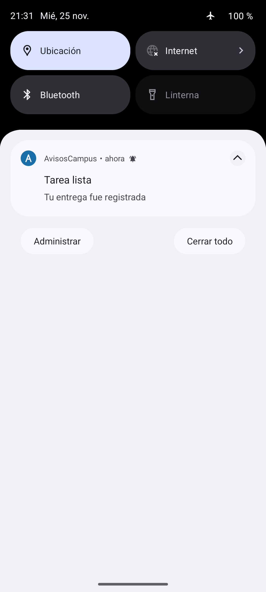
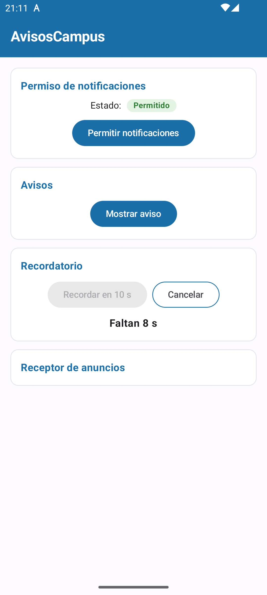
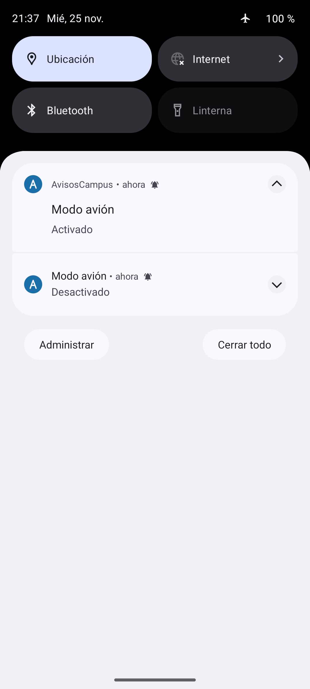
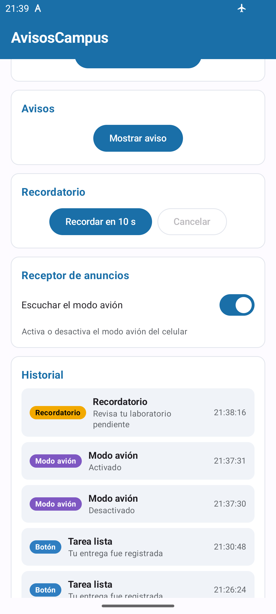
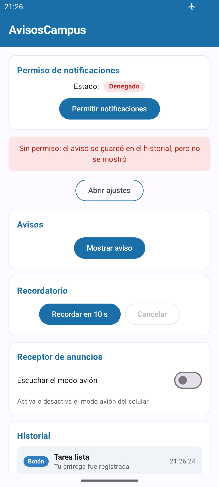

# AvisosCampus

App Android que muestra notificaciones locales y escucha lo que pasa en el celular. Con un botón muestra un aviso, con otro programa un recordatorio que llega a los 10 segundos y, si el usuario lo activa, avisa cuando se enciende o apaga el modo avión. Todo queda anotado en un historial.

Laboratorio de la Semana 15 · Notificaciones en Android · Programación en Móviles · 4to ciclo · Tecsup
Docente: Juan León S.
Estudiante: Alonso Abad Mejia ([@jordanabad797-pixel](https://github.com/jordanabad797-pixel))

## Tecnología

| Dato | Detalle |
|---|---|
| Lenguaje | Kotlin |
| UI | Jetpack Compose + Material 3 (sin XML) |
| Arquitectura | MVVM + Repository (interface) |
| Notificaciones | `NotificationChannel`, `NotificationCompat`, `PendingIntent` inmutable |
| Permiso | `POST_NOTIFICATIONS` en tiempo de ejecución (Android 13+) |
| Receptor | `BroadcastReceiver` registrado en Compose con `DisposableEffect` |
| Asincronía | Corrutinas (`viewModelScope`, `StateFlow`, `SharedFlow`) |

## Funcionalidades

- Canal **Avisos** creado una sola vez en la clase `Application`.
- Pedido del permiso de notificaciones con estado visible: **Sin pedir**, **Permitido** o **Denegado**.
- Notificación **Tarea lista** con id único por aviso; al tocarla abre la app y se quita.
- Recordatorio con cuenta regresiva de 10 s, cancelable y que sobrevive a la rotación.
- Receptor del modo avión que se activa con un `Switch` y se quita en `onDispose`.
- Historial con lo más reciente arriba: origen, título, texto y hora.
- Manejo del permiso denegado: el aviso se guarda, se muestra un mensaje de error y el botón **Abrir ajustes** lleva a los ajustes de notificaciones de la app.

## Estructura de paquetes

```
com.tecsup.avisoscampus/
├── AvisosApp.kt                    Application: crea el canal
├── MainActivity.kt                 Crea el ViewModel con su Factory
├── model/
│   └── Modelos.kt                  Aviso, Origen, PermisoUi
├── data/
│   └── AvisosRepository.kt         interface + AvisosRepositoryMemoria
├── notificacion/
│   └── Notificador.kt              canal, permiso y mostrar
├── receiver/
│   └── ModoAvionReceiver.kt        escucha ACTION_AIRPLANE_MODE_CHANGED
├── viewmodel/
│   ├── AvisosViewModel.kt          estado y lógica, sin Context
│   └── AvisosViewModelFactory.kt
└── ui/
    ├── PantallaAvisos.kt           tarjetas, permiso, receptor y eventos
    ├── HistorialAvisos.kt          tarjeta Historial
    └── theme/                      colores, tema y tipografía
```

## Arquitectura MVVM

```
View (PantallaAvisos)
   |  eventos: botones, switch                 ^  collectAsState()
   v                                           |
ViewModel (AvisosViewModel) --- StateFlow (avisos, permiso, faltan, escuchandoAvion, mensaje) --->
   |  registra el aviso                |  emite: eventos (SharedFlow<Aviso>)
   v                                   v
AvisosRepository (interface)        View recibe el evento y llama a
   -> AvisosRepositoryMemoria          Notificador.mostrar(context, aviso)
```

| Capa | Conoce a | No debe |
|---|---|---|
| View (`ui/`) | Solo a su ViewModel y al Notificador | Decidir qué se avisa ni guardar el historial |
| ViewModel | Solo a la interface del Repository | Conocer Composables, recibir un Context ni mostrar notificaciones |
| Repository | Nada de la UI | Usar Context |
| Notificador | El sistema (canal, NotificationManager) | Guardar estado de la app |

El ViewModel decide qué avisar y lo anota en el Repository; después emite un evento. La pantalla lo recibe y, como sí tiene Context, llama al Notificador. Así el ViewModel nunca toca el sistema de notificaciones y se puede probar sin Android.

## Capturas

| Notificación en el panel | Recordatorio | Modo avión |
|---|---|---|
|  |  |  |

| Historial | Permiso denegado |
|---|---|
|  |  |

## Pruebas de aceptación

Probadas en un emulador con Android 13 o superior.

| Prueba | Resultado esperado | OK |
|---|---|---|
| Abrir Ajustes → Apps → AvisosCampus → Notificaciones | Existe el canal Avisos | ✅ |
| Pulsar Permitir notificaciones | Aparece el cuadro de Android y la etiqueta cambia | ✅ |
| Pulsar Mostrar aviso | Aparece la notificación Tarea lista | ✅ |
| Pulsar Mostrar aviso dos veces | Aparecen dos notificaciones distintas | ✅ |
| Tocar la notificación | Se abre la app y la notificación desaparece | ✅ |
| Recordar en 10 s | Cuenta regresiva y aviso al llegar a 0 | ✅ |
| Recordar y minimizar la app | El aviso llega igual | ✅ |
| Recordar y cancelar | No llega ningún aviso | ✅ |
| Switch activado y cambiar el modo avión | Aviso Activado y luego Desactivado | ✅ |
| Switch desactivado y cambiar el modo avión | No hay aviso | ✅ |
| Permiso denegado y Mostrar aviso | Mensaje de error, aviso en el historial y la app no se cierra | ✅ |
| Rotar la pantalla durante el recordatorio | La cuenta regresiva continúa | ✅ |
| Revisar el código | No hay Context en `viewmodel/` y todo receptor registrado se quita en `onDispose` | ✅ |

## Para pensar

**1. ¿Por qué una notificación necesita un canal y un permiso? ¿Qué pasa si falta cada uno?**
Desde Android 8 (API 26) toda notificación debe pertenecer a un canal. El canal define la importancia, el sonido y la vibración, y le permite al usuario activar o desactivar cada tipo de aviso por separado desde Ajustes. Si el canal no existe, el sistema descarta la notificación y solo deja un error en Logcat. El permiso `POST_NOTIFICATIONS` existe desde Android 13 (API 33) para que sea el usuario quien decida si una app puede enviarle notificaciones. Si falta, `notify` no muestra nada; en esta app `Notificador.mostrar` lo detecta antes, devuelve `false` y la pantalla muestra el mensaje de error con el botón **Abrir ajustes**.

**2. ¿Por qué el ViewModel emite un evento y no muestra la notificación él mismo?**
Para mostrar una notificación hace falta un `Context`, y el ViewModel vive más que la Activity (sobrevive a la rotación). Si guardara un Context provocaría fugas de memoria y quedaría atado al framework de Android. Separando responsabilidades, el ViewModel solo decide qué avisar y lo registra en el Repository; la vista, que sí tiene Context, lo muestra. Además, el ViewModel se puede probar con pruebas unitarias sin emulador. Se usa un `SharedFlow` porque es un evento de una sola vez: al rotar la pantalla no se vuelve a disparar, como sí pasaría con un `StateFlow`.

**3. ¿Qué pasa si usas el mismo id en dos notificaciones?**
La segunda reemplaza a la primera: Android la trata como una actualización de la misma notificación y en el panel solo se ve una. Por eso se usa `aviso.id`, que el Repository genera de forma incremental, y cada aviso aparece como una notificación distinta.

**4. ¿Por qué `onReceive` debe ser corto y por qué hay que quitar el receptor al salir?**
`onReceive` se ejecuta en el hilo principal. Si hace trabajo largo, bloquea la interfaz y, pasados unos segundos, Android muestra un error ANR (la app no responde). Por eso solo lee el extra `state` y le pasa el valor al ViewModel. El receptor registrado en tiempo de ejecución guarda una referencia al Context de la pantalla: si no se quita, sigue recibiendo anuncios cuando la pantalla ya no existe y filtra memoria (Android lo reporta como `IntentReceiverLeaked`). Por eso se registra dentro de un `DisposableEffect` y se quita con `unregisterReceiver` en `onDispose`.

**5. ¿En qué casos usarías una notificación local y en cuáles una push de Firebase?**
Una notificación local la genera el mismo celular y no necesita internet ni servidor: sirve para recordatorios y temporizadores, para confirmar una acción del usuario (como «Tarea lista») o para reaccionar a eventos del propio dispositivo, como el modo avión o el cargador. Una push de Firebase Cloud Messaging la envía un servidor y llega aunque la app esté cerrada: sirve cuando el evento ocurre fuera del celular, como un mensaje de otro usuario, un anuncio del docente a todos los alumnos, una nota publicada o el cambio de estado de un pedido.
